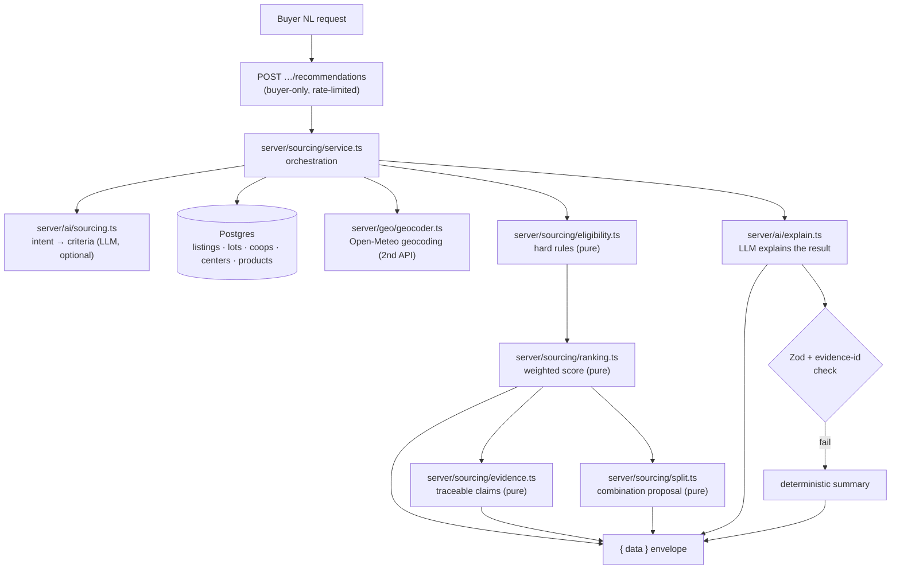

# AI Sourcing Agent — Solution Design

Status: implemented (algorithm v1.0.0).
Audience: reviewers/assessors of the AI Sourcing Agent upgrade, and future maintainers.

This document is the single reference for the buyer-facing **AI sourcing agent**:
what problem it solves, how it is architected, exactly which parts a language
model is (and is **not**) allowed to touch, how to run and demo it, and how its
output was evaluated. It complements — and never contradicts —
`docs/frontend-architecture.md` (§AI sourcing search, §Sourcing recommendations)
and `docs/frontend-design-direction.md`.

---

## 1. Problem & goals

A wholesale buyer on GebeyaLink needs to answer a concrete question: *"Can I get
this commodity, at this grade, in this quantity, at a workable price, from a
cooperative I can actually order from — and can I trust the answer?"* Today the
marketplace answers it one filter at a time, and the buyer must eyeball which
listings are real, which are large enough, and how they compare.

Goals:

1. **Natural-language intent** — a buyer describes the need in plain words.
2. **Trustworthy matches** — only suppliers that can *actually* take the order,
   checked against the same rules the order flow enforces.
3. **Explainability** — every claim is traceable to a database field or an
   explicit calculation; the ranking is a documented, deterministic formula.
4. **Honesty about limits** — missing/unverifiable data is surfaced, not faked.
5. **Partial fulfillment** — when no single supplier covers the request, propose
   a combination of *real* lots, clearly labelled as a proposal.
6. **AI that explains, never invents** — the model's role is bounded and its
   failure never removes the deterministic result.

Non-goals: reserving inventory, creating orders, negotiating, or pricing. The
agent is **read-only**.

---

## 2. Architecture

Two buyer-only endpoints:

| Endpoint | Purpose |
|---|---|
| `POST /api/v1/marketplace/ai-search/parse` | Intent → validated search criteria (existing). |
| `POST /api/v1/marketplace/ai-search/recommendations` | Ranked, explainable supplier matches (this upgrade). |

The `parse` contract is **unchanged**; the agent adds the sibling
`recommendations` route.



**Trust boundary.** Everything before `explain.ts` is ordinary TypeScript. The
model is only invited in at step 6, and only to write prose about numbers it
received. Its output is re-parsed with Zod and every evidence id is checked
against the server-generated set (`verifyReferences`), so the model cannot
introduce a supplier, price, quantity or certification that does not exist.

### File map

| File | Responsibility |
|---|---|
| `apps/web/server/sourcing/service.ts` | Candidate query + orchestration; assembles the DTO. |
| `apps/web/server/sourcing/eligibility.ts` | Hard eligibility rules (mirrors `server/orders/service.ts`). |
| `apps/web/server/sourcing/ranking.ts` | Transparent weighted scoring + deterministic tie-breaks. |
| `apps/web/server/sourcing/evidence.ts` | Builds the evidence set (field / calculation / rule). |
| `apps/web/server/sourcing/split.ts` | Greedy combination proposal (≥2 lines, each ≥ MOQ). |
| `apps/web/server/sourcing/config.ts` | Weights + distance bands + geocoder settings (constants). |
| `apps/web/server/geo/geocoder.ts` | Open-Meteo client (cached, throttled, degradable). |
| `apps/web/server/ai/sourcing.ts` | Intent parsing + clarifications/warnings. |
| `apps/web/server/ai/provider.ts` | Provider abstraction: `gemini` · `openai` · `mock`. |
| `apps/web/server/ai/explain.ts` | Explanation + evidence verification + deterministic fallback. |
| `apps/web/server/ai/rate-limit.ts` | Per-buyer rate limiting (fails open if Redis absent). |
| `apps/web/features/marketplace/components/sourcing-recommendations.tsx` | Buyer UI: shortlist, score bars, evidence, split, summary. |
| `packages/types/src/sourcing.ts` | Shared contracts for the whole pipeline. |
| `packages/validation/src/marketplace.ts` | Zod schemas for request + model outputs. |

---

## 3. Deterministic engine

### 3.1 Eligibility (hard rules)

A supplier is eligible only if it satisfies **every** rule. These mirror the
order-time checks in `server/orders/service.ts:220-284`, so a recommended
supplier can actually accept the order:

- listing is `active`;
- cooperative is `active`;
- (when requested) product matches, grade matches, price ≤ ceiling;
- available quantity ≥ requested quantity;
- available quantity ≥ **MOQ** (`MIN_ORDER_QUANTITY_KG`, default 1000).

A hard failure **can never be outranked** by a preference score — the caller
ranks only the eligible set. Ineligible-but-close listings are returned
separately as `partialMatches` with the exact failed rule(s).

### 3.2 Ranking (transparent score)

Five normalized components (0..1), each multiplied by a fixed weight:

| Component | Weight | Meaning |
|---|---:|---|
| quantity | 0.30 | Coverage of the requested quantity (with bounded headroom credit). |
| price | 0.25 | 1 at/below the buyer's ceiling; decays above it; else relative to the cheapest candidate. |
| grade | 0.20 | Exact grade match. |
| location | 0.15 | Proximity band from the geocoded origin — only when the buyer asked. |
| completeness | 0.10 | How complete the listing/cooperative record is. |

Weights are **constants**, not env-driven: a deployment silently changing how
one supplier outranks another would break auditability. Every response reports
`meta.algorithmVersion` (`SOURCING_ALGORITHM_VERSION = '1.0.0'`).

**Missing data is never an advantage.** A component whose data does not exist is
`status: 'unknown'`, scores **0**, and *keeps its weight*. A supplier with
unknown proximity therefore ranks below an otherwise-identical one whose
proximity is known — not above it.

**Deterministic tie-breaks** (after the score): better quantity coverage → lower
price → older listing (`createdAt`) → `listingId.localeCompare`. Equal
suppliers always order the same way, on every run.

### 3.3 Evidence

Every buyer-facing claim is a `EvidenceRef` produced by `evidence.ts`, tagged
`kind: 'field' | 'calculation' | 'rule'` and carrying the source column/rule and
the observed value:

- field evidence cites real columns (e.g. `inventory_lots.available_quantity`);
- calculation evidence states the arithmetic (distance, estimated cost, score);
- rule evidence records a platform rule or an eligibility failure.

Only buyer-visible fields are emitted — **no farmer identities, no contact
details**. The model may only *reference* these ids.

### 3.4 Split sourcing

When no single eligible supplier covers the request, `split.ts` greedily walks
the ranked list and proposes a combination:

- every contributing line is itself ≥ MOQ (otherwise the buyer could not place
  that order individually, so the line is excluded);
- at least **two** lines are required (a single line is not a "split");
- returns `coveredQuantityKg`, `shortfallKg`, `estimatedTotalCost`, and the
  documented `assumptions`.

It is a **proposal only**: it never reserves stock or creates orders. The buyer
still orders per supplier through the existing flow, which re-checks every rule
transactionally.

---

## 4. Failure model

| Failure | Behaviour |
|---|---|
| Explanation provider missing/unreachable/invalid | **HTTP 200**; `explanation.source = 'deterministic'`, with a `note`. Ranking is unaffected. |
| Intent parsing fails (`AiProviderError`) | Existing behaviour: **503** `ai_unavailable` (or 502 `ai_error`) — use the filters. |
| Model returns an evidence id not in the server set | The reference is **dropped** before responding. |
| Geocoder off/unreachable/no match | Distance is `unknown`, scored 0 and labelled unverified — never fabricated. |
| Buyer rate-limited | **429** `rate_limited`. |

The model never sees buyer identity or supplier contact details, and it cannot
read the database — it receives only the computed facts serialized in the prompt.

---

## 5. Third-party integrations

### 5.1 Language model (LMM provider)

`AI_PROVIDER ∈ {gemini, openai, mock}`.

- **Gemini** (default): native REST
  `POST https://generativelanguage.googleapis.com/v1beta/models/{model}:generateContent`
  with `x-goog-api-key` and `generationConfig.responseMimeType: 'application/json'`.
  Default model `GEMINI_MODEL=gemini-3-flash`.
- **OpenAI-compatible**: any `/chat/completions` endpoint (`AI_BASE_URL`).
- **mock**: deterministic, offline, no key — used by tests and e2e.

Quotas change over time and are **never hardcoded** in the codebase. The free
Gemini tier covers Flash/Flash-Lite models; check the current limits in Google
AI Studio.

### 5.2 Geocoding (second API)

`server/geo/geocoder.ts` uses **Open-Meteo Geocoding**
(`geocoding-api.open-meteo.com/v1/search`): no API key, HTTPS JSON GET, results
filtered to Ethiopia (`countryCode=ET`) and to populated places
(`feature_code` starts with `PPL`/`ADM`). It is:

- **cached** in-process (plus the existing Redis cache when configured, keyed by
  normalized query);
- **throttled** to one request per `GEOCODER_MIN_INTERVAL_MS` (default 1000);
- **degradable** — any failure yields `null`, which the ranker treats as
  "distance unverified".

> **Licensing limitation (documented, not hidden):** the Open-Meteo free tier is
> licensed for **non-commercial** use (CC BY 4.0 data). A commercial deployment
> must use a paid/self-hosted option. Set `GEOCODER_PROVIDER=off` to disable
> entirely (tests/e2e/offline); proximity then scores as `unknown`.

---

## 6. Configuration

All values are environment-driven except the ranking weights (constants). See
`.env.example` for the authoritative list.

| Variable | Default | Purpose |
|---|---|---|
| `AI_PROVIDER` | `gemini` | Provider selection. |
| `GEMINI_API_KEY` / `GEMINI_MODEL` / `GEMINI_BASE_URL` | — / `gemini-3-flash` / Google base | Gemini. |
| `AI_API_KEY` / `AI_MODEL` / `AI_BASE_URL` | — / `gpt-4o-mini` / OpenAI | OpenAI-compatible. |
| `GEOCODER_PROVIDER` | `open-meteo` | `open-meteo` or `off`. |
| `GEOCODER_BASE_URL` / `GEOCODER_TIMEOUT_MS` / `GEOCODER_MIN_INTERVAL_MS` | Open-Meteo / 8000 / 1000 | Geocoder. |
| `MIN_ORDER_QUANTITY_KG` | `1000` | MOQ. |
| `ORDER_RESPONSE_WINDOW_HOURS` | `24` | Reservation/response window. |

The agent introduces **no new database tables or migrations**.

---

## 7. Setup

```powershell
# from repo root
npm install

# apps/web/.env  (see .env.example)
#   DATABASE_URL=...            (required for all data)
#   AI_PROVIDER=mock            (zero-key, offline — recommended for demos/tests)
#   # or, for a real model:
#   AI_PROVIDER=gemini
#   GEMINI_API_KEY=...          (from https://aistudio.google.com/apikey)
#   GEOCODER_PROVIDER=open-meteo

npm run dev          # http://localhost:3000
```

No key is required to run or demo: `AI_PROVIDER=mock` plus
`GEOCODER_PROVIDER=off` exercises the full deterministic pipeline with a
deterministic explanation.

---

## 8. Demo script

1. Sign in as a **buyer**; open `/marketplace`.
2. In **Supplier recommendations**, type:
   *"5 tonnes of grade A coffee from Sidama under 300 ETB per kg"*.
3. Observe, in order:
   - the **Assistant summary** (AI explanation, or the deterministic summary
     when no provider is configured — the panel labels which);
   - the ranked **shortlist**, each card showing the cooperative, price,
     availability, fulfillment, and a **score breakdown bar** per component;
   - **evidence** under each card — expandable, each line citing a field or
     calculation;
   - the **combination option** when no single supplier covers the request,
     with per-line quantities/costs and the stated assumptions;
   - **closest matches that did not qualify**, each explaining the failed rule.
4. Note the footer: algorithm version, eligible/candidate counts, provider, and
   "no stock is reserved until you place an order".

To see the failure model: set `AI_PROVIDER=openai` with no key and repeat — the
request still returns 200 with a deterministic summary and the full ranking.

---

## 9. Evaluation

### 9.1 Automated tests

Pure-engine unit tests (no network, no database):

- `tests/sourcing-eligibility.test.ts` — every hard rule, MOQ, "reports all
  failures at once", unrequested-criteria behaviour.
- `tests/sourcing-ranking.test.ts` — weights sum to 1; unknown components score
  0 while keeping weight; price/quantity/location/completeness behaviour;
  deterministic tie-breaks; order stability.
- `tests/sourcing-split.test.ts` — declines for single-line/short cases; ≥2
  lines; each line ≥ MOQ; cost summation; shortfall; documented assumptions.
- `tests/sourcing-evidence.test.ts` — unique namespaced ids; real values;
  calculation vs rule tagging; **no farmer/contact fields**; failure + score
  evidence.
- `tests/geocoder.test.ts` — `haversineKm`; provider-off short-circuit; country
  filtering; caching; graceful degradation on HTTP error / malformed body.

Integration (real Postgres, mocked session, mock provider/geocoder):

- `tests/recommendations.test.ts` — auth/authz, 400 on empty, `{ data }`
  envelope, score+evidence on every recommendation, no eligible supplier carries
  a hard failure, safe explanation when the provider is missing, **read-only**
  (inventory sums unchanged), split is never a single line.

End-to-end (Playwright, `AI_PROVIDER=mock`, `GEOCODER_PROVIDER=off`):

- `e2e/sourcing-recommendations.spec.ts` — buyer sees the panel, gets a ranked
  recommendation for a seeded listing, plus score bars, evidence and the
  read-only notice.
- `e2e/ai-sourcing.spec.ts` — the existing parse flow still applies filters.

### 9.2 Manual evaluation rubric

For a live-model run, score each dimension:

| Dimension | Pass criteria |
|---|---|
| Grounding | Every number in the summary appears in the evidence; no invented supplier/price/certification. |
| Ranking sanity | The top supplier is full-coverage and within the ceiling; changing the ceiling/quantity changes the order as expected. |
| Honesty | Missing quantity/grade/location are stated as missing, not guessed. |
| Split validity | Each proposed line is a real eligible lot ≥ MOQ; the arithmetic matches the lines. |
| Degradation | With no provider key the same ranking is returned with a deterministic summary. |

### 9.3 Known limitations

- Delivery timing and certifications are **not tracked** in the data model;
  requests for them produce a clarification, never a fabricated claim.
- Locations are free text with **no stored coordinates**; distance is a
  great-circle estimate from geocoded text and is labelled unverified when the
  origin cannot be located confidently.
- The geocoder free tier is non-commercial (see §5.2).
- Split sourcing is greedy and rank-ordered (explainable, not cost-optimal).

---

## 10. Requirement traceability

| Requirement (source) | Where satisfied |
|---|---|
| Plain-language sourcing (frontend-architecture §AI sourcing search) | `server/ai/sourcing.ts`, parse route; criteria map 1:1 to `listMarketplaceQuerySchema`. |
| Only orderable suppliers (orders rules) | `server/sourcing/eligibility.ts` mirrors `server/orders/service.ts:220-284`. |
| Transparent, reproducible ranking | `server/sourcing/ranking.ts` + `config.ts`; `meta.algorithmVersion`. |
| Traceable claims | `server/sourcing/evidence.ts`; model refs verified in `explain.ts`. |
| Partial fulfillment | `server/sourcing/split.ts`; proposal only. |
| AI cannot invent facts | `explain.ts` (Zod + `verifyReferences`), model sees computed facts only. |
| Graceful degradation of AI | 200 + `deterministic` summary; parse keeps its 503 contract. |
| Second third-party API | `server/geo/geocoder.ts` (Open-Meteo), cached + throttled. |
| Read-only (no reservation) | `service.ts` only reads; verified by integration + e2e tests. |
| No schema change | No new tables/migrations; `docs/frontend-architecture.md` §Sourcing recommendations. |
